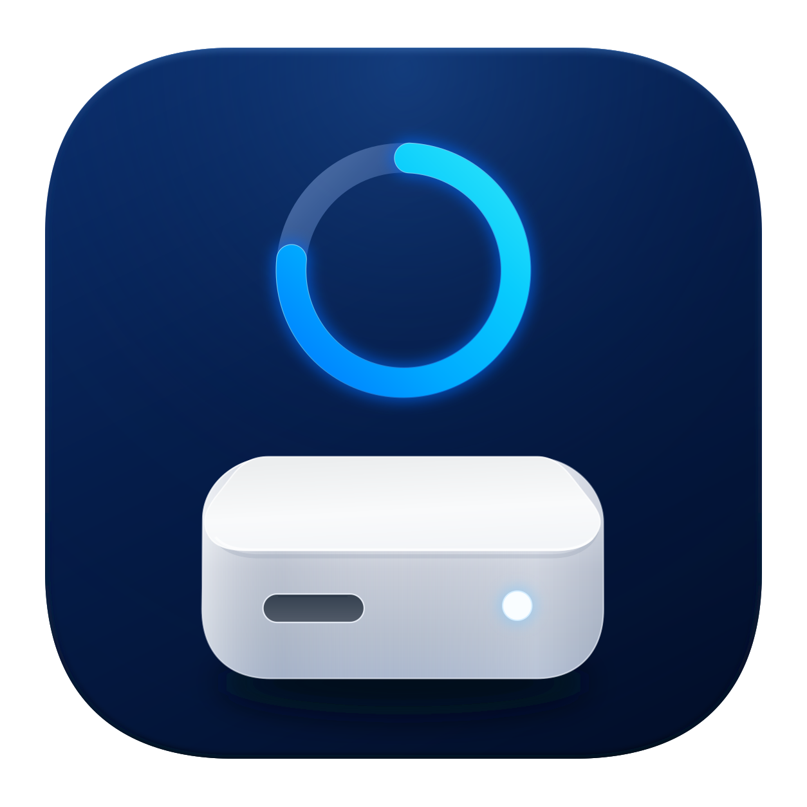
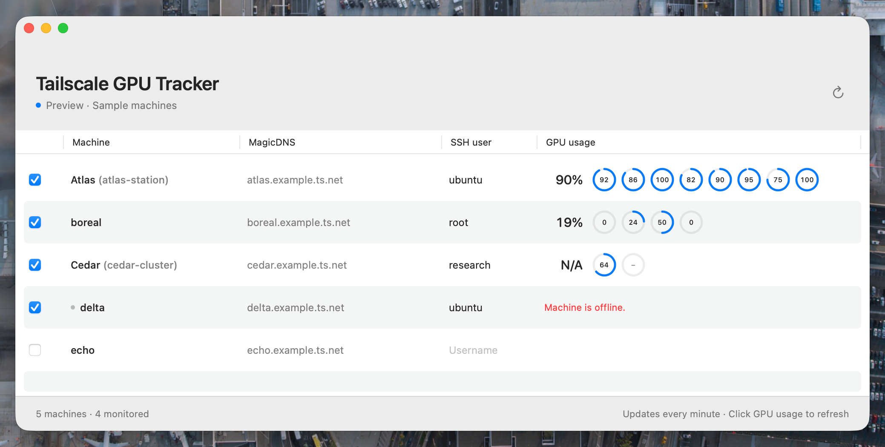
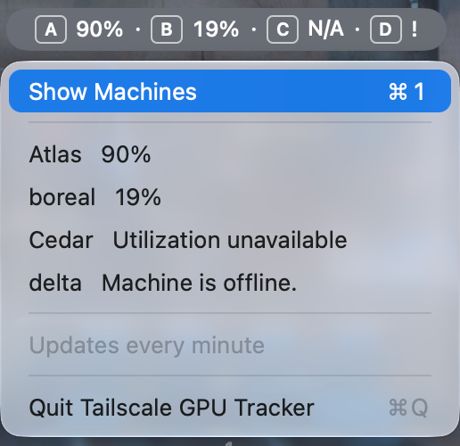

<p align="center">
  
  <h1 align="center">Tailscale GPU Tracker
    <span style="display: block">
      
      
    </span>
  </h1>
</p>

Monitor NVIDIA GPU usage across your Tailscale machines from a native macOS window and menu bar.



Select machines to monitor, enter their SSH usernames, and optionally give them aliases. The table shows each machine's average utilization and a ring for every GPU. Readings refresh every minute; click a GPU cell for an immediate update. Previous readings remain visible while refreshing, and connection errors appear in the row.

<p align="center">
  
</p>

Monitoring continues when the window is closed. Aliases, usernames, and selected machines are saved locally.

## Requirements

- macOS 14 or later.
- An installed, connected Tailscale client.
- NVIDIA GPUs with `nvidia-smi` available on the selected machines.
- Existing SSH access to the selected remote account.

The app uses your current Tailscale session and system SSH client. For machines that advertise Tailscale SSH host keys, it verifies the connection against those keys. Other SSH servers use your existing SSH configuration and known hosts. Connections run without password prompts. Access failures appear in the GPU cell, with the full message available on hover.

The SSH username identifies the remote account, such as `root` or `ubuntu`. SSH host keys identify the server. [Tailscale SSH](https://tailscale.com/docs/features/tailscale-ssh) uses your Tailscale identity to authorize access to the requested account.

## Install

Download the Apple Silicon app from [GitHub Releases](https://github.com/QZGao/tailscale-gpu-tracker/releases), unzip it, and move Tailscale GPU Tracker.app to Applications.

The app is not notarized. If macOS blocks it, choose "Open Anyway" in System Settings > Privacy & Security.

## Build from source

Requires Swift 6.0 or later.

```sh
make test
make run
```

`make package` creates a ZIP in `build/`.
